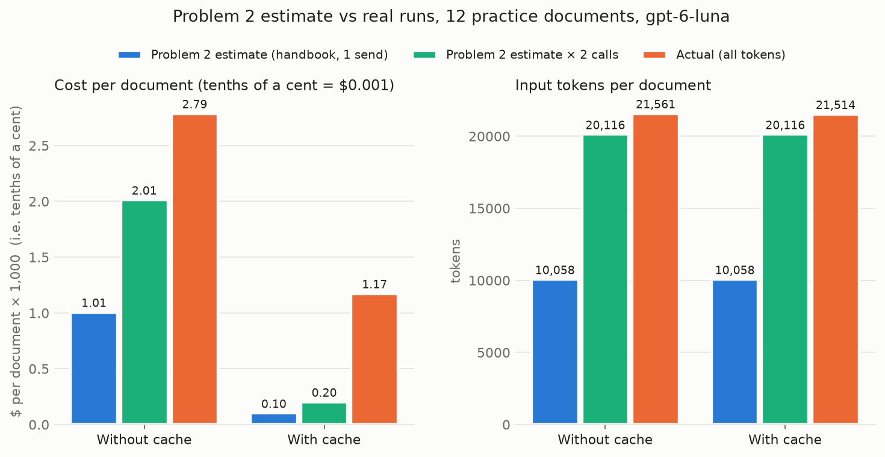

# Problem 4: With and Without Cached Tokens

Our vendor desk agent ran on all 12 practice documents twice, once **with** prompt caching and once **without**. Every model call (24 + 24 = 48) is saved in `output/cache_test.json` with its setup, document, every token count the API reported, and dollars from `data/prices.json`.

Reproduce: `.venv/bin/python scripts/cache_test.py` (runs the agent; costs real tokens), then `.venv/bin/python scripts/cache_report.py` (rebuilds this page and the chart from the JSON).

## The two setups, and proof each did what we think

| Setup | How it's configured | What the API reported | Verdict |
|---|---|---|---|
| **With cache** | `prompt_cache_options = {mode: explicit, ttl: 30m}` plus `openai_cache_instructions=True`: one cache breakpoint right after the stable prefix (`prompt.md` + the full handbook). The document and the conversation come after it. | **169,145 cached tokens** read across 16 of 24 calls | ✅ handbook reused from cache |
| **Without cache** | Explicit mode with **no** breakpoints (turns off OpenAI's implicit one), **and** a random `Request id` at the very start of the instructions on every request, so no prefix can ever match a stored one. | **0 cached tokens** on all 24 calls | ✅ nothing reused |

> **Why the random id was needed:** our first no-cache attempt used explicit mode with zero breakpoints (we checked the outgoing request body). The API still reported cache reads of about 10.5K tokens on half the calls, because OpenAI caches long prompts automatically. Per the assignment, a no-cache run with cached tokens doesn't count, so we threw that run out and re-ran with a prefix that changes on every request.

## 1. Cost: totals, per document, and savings

| | Without cache | With cache | Difference |
|---|---:|---:|---:|
| Documents | 12 | 12 | +0 |
| Model calls (requests) | 24 | 24 | +0 |
| Input tokens | 258,727 | 258,166 | -561 |
| … read from cache | 0 | 169,145 | +169,145 |
| … written to cache | 255,703 | 85,997 | -169,706 |
| Output tokens | 2,320 | 2,642 | +322 |
| … of which reasoning | 768 | 1,105 | +337 |
| **Total cost** | **$0.033425** | **$0.014065** | **−$0.019361** |
| **Cost per document** | **$0.002785** | **$0.001172** | **−$0.001613** |
| **Saved by caching** | | | **57.9%** |

### Where the dollars went

| Cost component | Rate / 1M | Without cache | With cache |
|---|---:|---:|---:|
| Uncached input | $0.100 | $0.000302 (1%) | $0.000302 (2%) |
| Cached input (read) | $0.010 | $0.000000 (0%) | $0.001691 (12%) |
| Cache write | $0.125 | $0.031963 (96%) | $0.010750 (76%) |
| Output | $0.500 | $0.001160 (3%) | $0.001321 (9%) |

### Per document

| Document | Without cache | With cache | Saved | Cached tokens (with cache) |
|---|---:|---:|---:|---:|
| p01_bluehen_quote.html | $0.002783 | $0.001598 | 43% | 10,516 |
| p02_elmcity_quote.html | $0.002786 | $0.001583 | 43% | 10,516 |
| p03_ivyprint_catalog.html | $0.002835 | $0.000350 | 88% | 21,256 |
| p04_harborstitch_quote.html | $0.002787 | $0.000367 | 87% | 21,053 |
| p05_maplemills_quote.pdf | $0.002736 | $0.001537 | 44% | 10,688 |
| p06_qtextile_quote.pdf | $0.002763 | $0.001545 | 44% | 10,535 |
| p07_longwharf_quote.pdf | $0.002803 | $0.001585 | 43% | 10,535 |
| p08_chapelst_email.eml | $0.002781 | $0.000379 | 86% | 21,072 |
| p09_westville_email.eml | $0.002823 | $0.001649 | 42% | 10,516 |
| p10_eastrock_email.eml | $0.002781 | $0.001579 | 43% | 10,536 |
| p11_yorkst_quote.html | $0.002772 | $0.001543 | 44% | 10,683 |
| p12_bluehen_quote.pdf | $0.002776 | $0.000348 | 87% | 21,239 |

| Cost-per-document statistic | Without cache | With cache |
|---|---:|---:|
| Mean | $0.002785 | $0.001172 |
| Median | $0.002782 | $0.001544 |
| Min | $0.002736 | $0.000348 |
| Max | $0.002835 | $0.001649 |
| Std. dev. | $0.000025 | $0.000574 |

## 2. Real numbers vs the Problem 2 estimate

Problem 2 priced only the handbook (10,058 tokens, counted with tiktoken), sent **once** per document.

| Quantity | Problem 2 estimate | Actual | Actual ÷ estimate |
|---|---:|---:|---:|
| Input tokens per model call | 10,058 (handbook only) | 10,780 | 1.07× |
| Model calls per document | 1 | 2 | 2× |
| Input tokens per document | 10,058 | 21,561 | 2.14× |
| Cost per document, without cache | $0.001006 | $0.002785 | 2.77× |
| Cost per document, with cache (warm: all reads) | $0.000101 | $0.001172 | 11.65× |
| 1,000 documents, without cache | $1.01 | $2.79 | 2.77× |
| 1,000 documents, with cache | $0.10 | $1.17 | 11.52× |
| Saving from caching | 89.9% | 57.9% | |

**What explains the gap:** the tokenizer count was close. Each call carries 722 tokens beyond the handbook (`prompt.md`, the tool schemas, the document, message framing), only 7% more. The big miss is the **2 model calls per document** (one to call `read_document`, one to answer). That sends the handbook twice, and the cost per document roughly doubles with it.

## 3. Projection: 1,000 documents a day for 30 days

30 days × 1,000 documents = **30,000 documents**, priced at the real cost per document measured above.

| Setup | Cost per document | Per day (1,000 docs) | 30 days |
|---|---:|---:|---:|
| Without cache | $0.002785 | $2.79 | **$83.56** |
| With cache (as measured here) | $0.001172 | $1.17 | **$35.16** |
| **Saved** | $0.001613 | $1.61 | **$48.40 (58%)** |
| With cache, every call a hit (best case) | $0.000365 | $0.37 | $10.95 |

At 1,000 documents a day (one every ~86 seconds over a 24-hour day, far more often over a workday) the cache never sits idle for its 30-minute TTL. So in steady production the bill should fall between the measured and best-case rows, if the routing misses we saw (surprise 2) shrink with traffic. Caching is worth about $48 a month at the hit rate we measured, and up to $73 a month if every call hits.

## 4. What's surprising in the numbers, and why

1. **"Without cache" still pays the cache-write premium.** No call read a single cached token, yet the API reported 255,703 **cache-write** tokens (99% of input), billed at $0.125/1M instead of $0.10. OpenAI stores long prompts automatically whether or not anything reuses them. A unique prefix stops the reads but not the writes. That's why the no-cache bill is 96% cache writes and lands above Problem 2's plain-input estimate. Turning caching "off" makes the bill **worse** than never having caching at all.
2. **With cache, 8 of 24 calls still missed, often seconds after a hit on the same prefix.** Caching is best-effort. Our run kept alternating: request 1 of a document reads about 10.5K cached tokens, then request 2 of the *same* document, seconds later, reads 0 and rewrites about 10.7K at the 1.25× rate. A cache only helps the server that holds it, so this looks like our requests being spread across servers (and possibly across OpenAI backends behind the Portkey gateway; we can't see that). We tried a fixed `prompt_cache_key`, OpenAI's tool for routing similar requests to the same cache, on 4 documents. It did not help (2 of 4 documents still missed on both calls), so we left it out. Each miss costs about 10× a hit, which is why the measured saving (58%) falls well short of Problem 2's 90%.
3. **Cache reads come in more than one size.** Most hits read about 10,516 to 10,536 tokens, the stable prefix (prompt + handbook) up to our breakpoint. But 4 calls read about 10,680 to 10,720, i.e. the whole previous request including the tool call. So OpenAI also caches at the end of a request, even in explicit mode. Whatever comes after the cached part (the document, the new turn) bills at the normal input rate.
4. **The second call per document is the hidden doubler.** The model needs one call to ask for `read_document` and another to answer. Both carry the full handbook. Reading the document in code and passing it in up front would halve the calls, a lever for later problems.
5. **Output is tiny but not free.** About 220 output tokens per document (42% of them hidden reasoning) cost 5× input per token. With caching, output is 9% of the bill, so once input is cheap, short answers matter.
6. **The answers aren't a caching story: 7/12 decisions right without cache, 8/12 with cache.** The difference is p03, where the model happened to resist the injection on one run and not the other. The same input doesn't always give the same answer. The wrong ones are not caching bugs. The baseline agent fell for prompt injections hidden in those documents (fake lower prices, fake lead times, a fake vendor name). That's the safety half of this homework. These cost runs used the original, undefended agent (`python agent.py --no-defense`). The defense added afterwards changes the prompt slightly, but not the cost picture.
